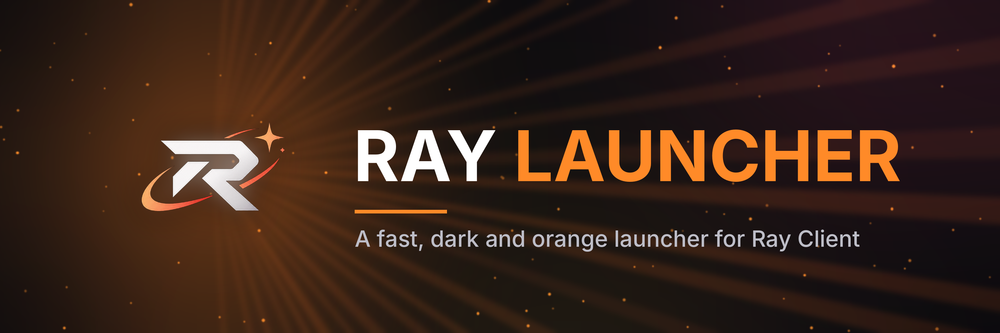

<div align="center">



# Ray Launcher
A dark-blue, Minecraft-styled launcher for Ray Client, with one-click modded instances.

</div>

> Ray Launcher is a fork of [OneLauncher](https://github.com/Polyfrost/OneLauncher) by Polyfrost, licensed under
> GPL-3.0-only. See [ATTRIBUTION.md](./ATTRIBUTION.md).

## Installing

Grab the latest release from the [GitHub releases](https://github.com/your-org/RayLauncher/releases/latest) page
(replace `your-org` with the account that hosts your fork).

| Windows (x86_64) | macOS (Intel & Apple Silicon) | Linux (x86_64) |
|------------------|-------------------------------|----------------|
| Installer        | DMG                           | AppImage       |
|                  | App Bundle                    | DEB            |
|                  |                               | RPM            |

Auto-update is **off** unless you build with your own signed update feed (see [Build-time configuration](#build-time-configuration)).

## Look and feel

Ray Launcher ships four built-in themes, all in the deep-navy palette used by Ray Client:

| Theme            | Style                                             |
|------------------|---------------------------------------------------|
| Ray Craft Dark   | Pixel font, square corners, pixel icons (default) |
| Ray Craft Light  | Same, light variant                               |
| Ray Dark         | Smooth, rounded                                   |
| Ray Light        | Smooth, rounded, light variant                    |

Themes are plain JSON in [`packages/rayclient_app/assets/themes/`](./packages/rayclient_app/assets/themes).

## Contributing

Please read the [contributing guidelines](CONTRIBUTING.md) before getting started.

### Requirements

The project targets **Rust 1.97** or later. You can install Rust via [rustup](https://rustup.rs/).

### Building & Running

```sh
# Run the app
cargo run -p rayclient_app

# Build a release binary
cargo build -p rayclient_app --release
```

### Build-time configuration

A stock build talks to no Ray-owned services. Opt in to each one with an environment variable at compile time:

| Variable                | Enables                                                                    |
|-------------------------|----------------------------------------------------------------------------|
| `RAY_UPDATER_ENDPOINT`  | Auto-update feed URL (also needs `RAY_UPDATER_PUBKEY`, a minisign public key) |
| `RAY_UPDATER_PUBKEY`    | Public key used to verify updates                                          |
| `RAY_RELEASES_URL`      | Release page shown when an update can't be installed automatically         |
| `RAY_SENTRY_DSN`        | Crash reporting to your own Sentry project                                 |
| `RAY_DISCORD_CLIENT_ID` | Discord rich presence under your own Discord application                   |
| `RAY_SUPPORT_URL`       | Target of the "get help" buttons                                           |

At runtime, `RAY_DISABLE_AUTOUPDATE=1` and `RAY_DISABLE_JAVA_AUTOINSTALL=1` turn those features off.

### Packaging / Releasing

Installers are produced with [**cargo-packager**](https://github.com/crabnebula-dev/cargo-packager). Config lives in
[`packages/rayclient_app/Cargo.toml`](./packages/rayclient_app/Cargo.toml) under `[package.metadata.packager]`.

```sh
cargo install cargo-packager --locked
cargo build --release -p rayclient_app
cargo packager --release -p rayclient_app --formats <targets>
#   Windows: nsis      macOS: app,dmg      Linux: deb,appimage
```

### Versioning

The workspace shares a single version, defined in the root [`Cargo.toml`](./Cargo.toml) under `[workspace.package]`.
Versions and release notes come from [Knope](https://knope.tech) change files in [`.changeset/`](./.changeset).
